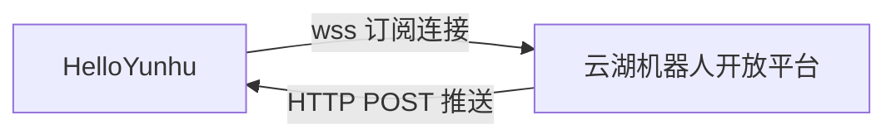

# 配置说明

本文逐项说明 `config.yaml` 的字段：类型、默认值、什么时候需要修改，以及写错时的表现。首次接入的完整流程见[快速开始](quickstart.md)，报错排查见[常见问题](troubleshooting.md)。

配置只从文件读取，环境变量的同名内容会被忽略。进程启动时一次性加载并校验，全部通过之后才建立连接；修改配置后重启进程生效。

## 1. 文件位置与加载

默认读取工作目录下的 `config.yaml`，`run` 与 `selftest` 都接受 `-config` 参数指定其他路径：

```
helloyunhu run -config /etc/helloyunhu/config.yaml
```

文件不存在时，`run`（包括不带参数直接运行）会生成一份模板、提示需要填写的两项并退出，退出码为 0；第二次运行才加载配置。模板的权限固定为 0600，因为里面会写入机器人令牌。

加载过程有两道检查。第一道拒绝未知字段，字段名拼错或者沿用了旧版结构时立刻报错，例如旧版的 `instances` 会得到：

```
解析配置文件 config.yaml: YAML 格式错误: yaml: unmarshal errors:
  line 1: field instances not found in type config.Config
```

第二道校验取值，并把发现的问题一次性列出，逐条改完再启动即可：

```
配置校验未通过:
bot.token: 不能为空
onebot: 至少需要配置一个框架连接
```

## 2. bot

| 字段 | 类型 | 默认值 | 说明 |
|---|---|---|---|
| `token` | 字符串 | 无，必填 | [云湖](https://www.yhchat.com/)机器人令牌 |

一个进程服务一个云湖机器人，多个机器人各自启动一个进程并各用一份配置。令牌只放在配置文件里，日志与诊断接口都不输出它。

## 3. receive

事件有两种来源，`receive.mode` 决定使用哪一种，或者两种同时使用。



### 3.1 mode

| 取值 | 含义 | 适用场景 |
|---|---|---|
| `websocket` | 只用订阅连接接收事件，默认值 | 部署在内网、家用宽带或容器里，云湖访问不到本机 |
| `webhook` | 只用 HTTP 推送接收事件 | 有公网入口的服务器，或者经过反向代理、内网穿透的部署 |
| `both` | 两种来源同时使用，按事件标识去重 | 迁移期间、或者希望推送链路中断时仍有订阅兜底 |

订阅连接由 HelloYunhu 向云湖发起，只需要机器人令牌，部署侧要求最低。Webhook 由云湖向 HelloYunhu 发起 HTTP 请求，监听端口必须能被云湖访问，推送地址是 `http://<listen>/yunhu/<token>`。

`both` 模式下两种来源的事件进入同一条处理链路，重复的事件按 `eventId` 丢弃。去重表保存在内存里，保留十分钟，容量 4096 条，进程重启后清空。

### 3.2 webhook

这一段只在 `mode` 取 `webhook` 或 `both` 时生效。

| 字段 | 类型 | 默认值 | 说明 |
|---|---|---|---|
| `listen` | 字符串 | `127.0.0.1:8081` | 监听地址，写成 `主机:端口`；`0.0.0.0:8081` 表示所有网卡 |
| `token` | 字符串 | 空，必填 | 推送路径里的令牌，至少 24 个字符 |
| `allowed_ips` | 字符串列表 | 空 | 允许的来源网段，留空表示接受任意来源 |

云湖的推送没有请求签名，**路径里的令牌是唯一凭据，知道完整地址的任何人都可以伪造事件**。令牌建议用随机生成的 32 位十六进制字符串，泄露后同时修改本文件与云湖控制台的订阅地址。

`allowed_ips` 使用 CIDR 写法，单个地址写成 `/32`（IPv4）或 `/128`（IPv6）：

```yaml
receive:
  mode: webhook
  webhook:
    listen: 0.0.0.0:8081
    token: "7c1f0a9e5b2d48c3a6f1e0d9b8c7a6f5"
    allowed_ips:
      - 203.0.113.0/24
```

云湖的出口网段需要以平台公布的地址为准；列表填错时，合法事件会被拒绝并记录一条「Webhook 来源不在允许的网段内」的日志。

## 4. onebot

`onebot` 是一组到机器人框架的反向 WebSocket 连接，至少配置一项。每项对应一个框架，事件转换一次之后广播给所有连接。

| 字段 | 类型 | 默认值 | 说明 |
|---|---|---|---|
| `name` | 字符串 | `onebot-1`、`onebot-2`…… | 日志与诊断接口里使用的连接名称，同一份配置内唯一 |
| `url` | 字符串 | 无，必填 | 框架监听的地址，协议取 `ws` 或 `wss` |
| `access_token` | 字符串 | 空 | 框架侧配置的访问令牌，两侧取值一致 |

```yaml
onebot:
  - name: astrbot
    url: ws://127.0.0.1:6199/ws
    access_token: ""
  - name: nonebot
    url: ws://127.0.0.1:8080/onebot/v11/ws
    access_token: ""
```

几条运行规则：

- 每条连接独立重连，间隔从 1 秒开始按 2 倍增长，上限 30 秒，连接建立之后重新从 1 秒算起。单条连接断开只影响它自己，进程继续运行。
- 所有连接共用同一个云湖接口客户端与限流器，因此 `yunhu.rate_limit` 是全部连接的合计上限。
- 框架断开期间收到的事件直接丢弃，日志里记录一条「框架连接尚未建立，事件已丢弃」。平台侧没有补发机制，需要补数据时由框架自行查询。

## 5. log

| 字段 | 类型 | 默认值 | 说明 |
|---|---|---|---|
| `level` | 字符串 | `info` | 取值 `debug`、`info`、`warn`、`error` |
| `format` | 字符串 | `text` | `text` 便于终端阅读，`json` 便于日志采集 |
| `raw_events` | 布尔 | `false` | 为真时在 debug 级别输出收到的原始事件，每条截断到 4 KB |
| `keep_days` | 整数 | `30` | 日志保留天数，`-1` 表示永不删除，`0` 会被拒绝 |
| `compress` | 布尔 | `true` | 为真时把前一天的日志压缩成 `.log.gz` |

日志同时写入终端与工作目录下的 `logs/`，文件名是当天日期，例如 `2026-11-15.log`。跨天之后的第一次写入会切换到新文件，前一天的旧文件在后台压缩并按 `keep_days` 清理，过期判断按日期计算。

`raw_events` 用于核对平台字段，原始事件里包含消息正文、昵称与群标识，排查结束后改回 `false`。压缩后的日志用 `zcat 2026-11-14.log.gz` 查看，Windows 上可以用 7-Zip 一类工具打开。

## 6. storage

| 字段 | 类型 | 默认值 | 说明 |
|---|---|---|---|
| `path` | 字符串 | `data/helloyunhu.db` | SQLite 文件路径，所在目录不存在时自动创建 |
| `message_ttl` | 时间间隔 | `168h` | 消息标识映射的保留时长，必须大于 0 |

云湖的消息标识是 32 位十六进制字符串，[OneBot](https://github.com/botuniverse/onebot-11) 侧要求整数，两者之间靠这张表对应。引用回复与撤回都依赖它：进程重启之后，只要记录还在保留期内，旧消息仍然可以引用与撤回。

过期记录在启动时清理一次，之后每小时清理一次；`message_ttl` 小于一小时时按保留时长执行。记录过期之后，`get_msg` 返回 1404，引用会被忽略并记录一条「引用的消息不在映射表中，已忽略引用」。

时间间隔使用 Go 的时长写法，例如 `168h`、`720h`、`30m`。

## 7. yunhu

| 字段 | 类型 | 默认值 | 说明 |
|---|---|---|---|
| `api_base` | 字符串 | `https://chat-go.jwzhd.com/open-apis/v1` | 开放接口的基础地址 |
| `subscribe_url` | 字符串 | `wss://ws.jwzhd.com/subscribe` | 事件订阅端点，令牌以查询参数追加 |
| `rate_limit` | 整数 | `10` | 每秒最多发起的接口调用次数，`0` 表示不限流 |

平台对每个接口限制每秒十次调用，超限返回错误码 1007。默认值 10 与平台上限一致，程序按匀速放行，发送消息这条路径不做重试。

`api_base` 与 `subscribe_url` 一般保持默认值。订阅端点属于未公开接口，平台调整地址时在这里修改，不需要重新编译。

## 8. capabilities

这两个字段回答框架对 `can_send_image` 与 `can_send_record` 的查询，属于对外声明，修改它们不改变程序的发送方式，只影响框架的选择。

| 字段 | 类型 | 默认值 | 说明 |
|---|---|---|---|
| `can_send_image` | 布尔 | `true` | 声明可以发送图片 |
| `can_send_record` | 布尔 | `false` | 声明可以发送语音气泡 |

云湖没有语音发送接口，语音只能按文件上传，客户端收到的是一个文件。把 `can_send_record` 改成 `true` 之后，框架会送来 `record` 段，程序仍然按文件发送，启动日志里会出现一条对应的警告。

## 9. media

两个方向的媒体体积上限，与代理服务无关。

| 字段 | 类型 | 默认值 | 说明 |
|---|---|---|---|
| `inline_limit` | 体积 | `20MiB` | 云湖的多媒体超过该体积时，不再内联为 base64，消息段里只给出地址 |
| `read_limit` | 体积 | `20MiB` | 框架给出的多媒体超过该体积时，放弃这次发送 |

接收方向先由程序下载云湖的媒体，再以 `base64://` 放进发给框架的事件。调大 `inline_limit` 意味着更大的 WebSocket 帧与更高的内存占用，WebSocket 帧过大时框架可能直接断开，按框架能承受的程度决定。

发送方向读取框架给出的 `base64://`、本地文件或网络地址，超过 `read_limit` 就放弃这次发送。云湖自身的上传上限另计：图片 10 MB，文件与视频各 20 MB，调大这一项不会突破平台限制。

体积写成带单位的字符串，`B`、`KiB`、`MiB`、`GiB` 按 1024 进位，`KB`、`MB`、`GB` 按 1000 进位。`inline_limit` 不超过 64 MiB。

## 10. proxy

对外提供云湖媒体与头像的 HTTP 服务，默认关闭。客户端拿到的地址由本程序代取，取图时附带云湖 CDN 要求的来源头。

```yaml
proxy:
  enabled: false
  listen: 127.0.0.1:8082
  base_url: ""
  stream_threshold: 8MiB
  media_max: 1GiB
  concurrency: 4
```

| 字段 | 类型 | 默认值 | 说明 |
|---|---|---|---|
| `enabled` | 布尔 | `false` | 为真时启动代理服务 |
| `listen` | 字符串 | `127.0.0.1:8082` | 监听地址，写成 `主机:端口` |
| `base_url` | 字符串 | 按 `listen` 推导 | 客户端访问代理时使用的地址，只填协议、主机与端口 |
| `stream_threshold` | 体积 | `8MiB` | 超过该体积的媒体改为边取边发 |
| `media_max` | 体积 | `1GiB` | 单次转发的体积上限，`0` 表示不限 |
| `concurrency` | 整数 | `4` | 同时向上游发起的取图请求数，取值 1 到 32 |

启用之后提供两个路径：

| 路径 | 内容 | 需要 |
|---|---|---|
| `/media/<token>` | 图片、文件、视频、语音，原样转发 | 仅 `proxy.enabled` |
| `/avatar/<标识>` | 用户头像，转成 JPEG 或 PNG | `proxy.enabled` 与 `compat.gensokyo.enabled` 同时为真 |

`/media/<token>` 里的 `token` 是原始地址的 base64url 编码，因此不需要维护地址表，重启后旧地址仍然可用。允许访问的域名固定为云湖的 CDN，其余地址返回 404。

不超过 `stream_threshold` 的媒体先取完再返回，响应要么完整要么报错；超过的媒体边取边发，`Content-Length` 原样透传，中途断开时客户端能按长度不符判定失败。`Range` 请求原样转给上游，视频拖动可用。

### 10.1 base_url 怎么填

留空时按 `listen` 推导：监听在 `0.0.0.0` 或 `[::]` 上时取回环地址 `127.0.0.1`，端口取 `listen` 的端口。框架与本程序在同一台机器时保持留空即可。

框架在另一台机器时，推导出来的 `127.0.0.1` 在客户端那边指向它自己，必须显式填写框架能访问到的地址，例如 `http://192.168.1.5:8082`。

### 10.2 大文件

超过 `media.inline_limit` 的媒体不内联，消息段里只给出地址。代理启用时这个地址是 `/media/<token>`，客户端按需去取，不受 WebSocket 帧的限制；代理未启用时是云湖的原始地址，客户端请求会得到 403。

## 11. compat

这一段是给非标准客户端准备的兼容设置，默认关闭。

```yaml
compat:
  gensokyo:
    enabled: false
```

| 字段 | 类型 | 默认值 | 说明 |
|---|---|---|---|
| `enabled` | 布尔 | `false` | 自报 `gensokyo` 并实现 `get_avatar`，需要 `proxy.enabled` 同时为真 |

### 11.1 为什么需要

Overflow 这类 mirai 客户端要为每个成员显示头像，但 OneBot v11 没有头像字段。它只在协议端自报的名字等于 `gensokyo` 时才调用非标准的 `get_avatar`，其余情况一律把整数标识当作 QQ 号去 qlogo 取，接在云湖上显示的是陌生人的头像。

云湖的头像地址位于图片 CDN，请求需要带 `Referer: https://myapp.jwznb.com`，客户端直接下载会得到 403。因此地址必须由程序代取，代取由 `proxy` 段提供。

### 11.2 开启与关闭的差别

| 项目 | 关闭 | 开启 |
|---|---|---|
| `get_version_info` 的 `app_name` | `HelloYunhu` | `gensokyo` |
| `get_avatar` | 返回 1404 | 返回代理地址加 `/avatar/<标识>` |
| 头像地址表 | 不建立 | 从消息事件与查询结果里收集 |

这一项不影响图片、文件、视频与语音的转发，那些由 `proxy.enabled` 单独控制。

头像路径只接受 `GET /avatar/<标识>`，取图时附带来源头，单张上限 1 MiB，缓存 6 小时。没有见过的用户返回一张灰色占位图，而不是 404，避免客户端把它当成错误。

云湖头像的实际内容是 webp，地址却以 `.jpg` 结尾。Java 的 `ImageIO` 不认识 webp，插件读出来是 null，因此代理会在返回前转码：不透明的图转成 JPEG，带透明通道的转成 PNG，客户端拿到的始终是它认识的格式。

### 11.3 副作用

开启后框架的日志、状态命令与 `get_version_info` 的返回都会显示 `gensokyo`，与本项目的真实身份不一致，排查问题时不要误认为接入了那个项目。

这个开关只对按名字判断能力的客户端有效。AstrBot 与 NoneBot2 不调用 `get_avatar`，开启之后它们的头像仍然按整数标识去 QQ 头像服务取。

## 12. tags

这一段控制群标签与 `set_group_special_title` 的行为。云湖用群标签表达 QQ 的专属头衔，一个成员可以挂多个标签。

```yaml
tags:
  auto_create: true
  color: "#03A9F4"
  report_owner: true
  special_title:
    mode: replace
    clear_on_empty: true
```

| 字段 | 类型 | 默认值 | 说明 |
|---|---|---|---|
| `auto_create` | 布尔 | `true` | 设置头衔时标签不存在就自动创建 |
| `color` | 字符串 | `#03A9F4` | 自动创建标签时使用的颜色，格式为 `#RRGGBB` |
| `report_owner` | 布尔 | `true` | 持有标签管理权限的机器人按群主上报角色 |
| `special_title.mode` | 字符串 | `replace` | `replace` 表示设置后只剩这一个标签，`append` 表示只追加 |
| `special_title.clear_on_empty` | 布尔 | `true` | 头衔置空时解绑该成员的全部标签 |

### 12.1 两种语义怎么选

| 取值 | 适合的场景 |
|---|---|
| `replace` | 插件按 QQ 的单值头衔写，期望最后一次设置生效 |
| `append` | 群里的标签由人工维护，不希望插件碰掉成员已有的标签 |

`clear_on_empty` 与 `mode` 是正交的。`replace` 加 `clear_on_empty` 为真是与 QQ 一致的行为：设置即覆盖，置空即清除。`append` 加 `clear_on_empty` 为假时，机器人只能加标签，从不删除，适合标签由群主统一管理的群。

`clear_on_empty` 为假时置空返回 1500 与说明，不静默成功。调用方以为清掉了、实际没清，比直接报错更难排查。

### 12.2 自动创建

打开 `auto_create` 之后，插件设置任意头衔都能生效，不需要群主事先建好同名标签。新建的标签使用 `color`，描述留空，排序由平台决定，并在日志里记一条「已自动创建群标签」，含群标识与标签名，便于事后清理。

关闭之后，标签不存在时返回 1500，说明里列出群内已有的标签，例如「群 695367192 没有名为「新人」的标签，现有标签：VIP用户、活跃用户」。

自动创建只作用于标准接口。六个 `yunhu_*` 扩展接口不会创建标签，标签不存在时直接报错。

### 12.3 角色上报

QQ 里设置专属头衔只有群主能做，因此按 QQ 语义检查机器人资格的头衔插件会要求 `owner`。云湖把这件能力拆成 `allowGroupTagManage` 一个开关，拿到开关的机器人在这一件事上等价于群主。`report_owner` 为真时，这类机器人在 `get_group_member_info` 与 `get_group_member_list` 里报 `owner`，插件才会放行。

打开之后插件会认为机器人拥有群主全部能力，包括云湖没有开放的操作，例如全体禁言、设置管理员、转让群。这些调用返回 1404 与说明，不会静默成功。改成假则退回按管理员上报，适合插件对 `owner` 有过强假设的部署。

这个开关只影响机器人自己的角色，操作人的角色仍然是真实身份。要求操作人必须是群主的插件，在云湖里仍然只认群主，形如管理员触发设置头衔会被拒绝。

### 12.4 代价

标签没有读取成员关联的接口，程序无法知道某个成员身上有哪些标签。因此替换与清空都是逐个解绑，调用次数等于群内标签数量，全部经过每秒十次的限流。群内标签很多时，一次设置可能需要几秒。

替换采用先绑定后解绑的顺序，成员不会出现没有头衔的中间态，绑定失败时也不会动到旧标签。

## 13. diagnostics

| 字段 | 类型 | 默认值 | 说明 |
|---|---|---|---|
| `enabled` | 布尔 | `false` | 为真时启动只读诊断接口 |
| `listen` | 字符串 | `127.0.0.1:9090` | 监听地址 |

启用之后提供两个只读端点：

| 端点 | 返回 |
|---|---|
| `GET /healthz` | 固定文本 `ok` |
| `GET /status` | JSON，包含版本、启动时间、运行秒数、机器人标识、昵称、各连接在线状态、已处理的事件数与调用数 |

`/status` 的字段依次是 `version`、`started_at`、`uptime_seconds`、`bot_id`、`nickname`、`connections`（每项含 `name` 与 `online`）、`events_received` 与 `actions_handled`。接口不接受写请求，也不输出消息正文与用户标识，因此只在本机监听即可，需要远程查看时通过 SSH 端口转发访问。

## 14. 常见组合

单框架、订阅方式，即首次接入的最小配置：

```yaml
bot:
  token: "机器人令牌"

onebot:
  - name: astrbot
    url: ws://127.0.0.1:6199/ws
```

两个框架同时接入：

```yaml
onebot:
  - name: astrbot
    url: ws://127.0.0.1:6199/ws
  - name: nonebot
    url: ws://127.0.0.1:8080/onebot/v11/ws
```

Webhook 接收，适合部署在公网服务器：

```yaml
receive:
  mode: webhook
  webhook:
    listen: 0.0.0.0:8081
    token: "7c1f0a9e5b2d48c3a6f1e0d9b8c7a6f5"
    allowed_ips:
      - 203.0.113.0/24
```

Overflow 接入并同时使用头像与媒体代理：

```yaml
proxy:
  enabled: true
compat:
  gensokyo:
    enabled: true
onebot:
  - name: overflow
    url: ws://127.0.0.1:6200/ws
```

`base_url` 保持留空即可，前提是 Overflow 与 HelloYunhu 在同一台机器上。分机器部署时按第 10.1 节填写。

只让依赖消息段 `url` 的客户端能取图，不需要自报名字时，把 `compat.gensokyo.enabled` 留成 `false`，只开 `proxy.enabled`。

多个云湖机器人：每个机器人一份配置、一个进程、一个独立的工作目录。`storage.path` 与日志目录都相对于工作目录，分开之后各机器人的数据库与日志互不影响。

## 15. 校验错误对照

| 报错 | 原因 |
|---|---|
| `bot.token: 不能为空` | 没有填写机器人令牌 |
| `onebot: 至少需要配置一个框架连接` | `onebot` 为空或者整段缺失 |
| `onebot[0].name: 与 onebot[1] 重复` | 两个连接的名称相同 |
| `onebot[0].url: 协议必须是 ws 或 wss` | 地址写成了 `http://` 或者漏掉了协议 |
| `receive.mode: "…" 不受支持` | 取值超出 `websocket`、`webhook`、`both` |
| `receive.webhook.token: 至少 24 个字符` | 令牌长度不足 |
| `receive.webhook.allowed_ips: "…" 不是合法的网段` | 没有写成 CIDR 形式，例如填了 `203.0.113.1` |
| `log.keep_days: 必须是 -1 或大于 0` | 填了 `0` 或者负数 |
| `storage.message_ttl: 必须大于 0` | 时长为零或者写法无法解析 |
| `media.inline_limit: 不超过 64 MiB` | 内联上限超过了允许范围 |
| `media.inline_limit: 必须大于 0` | 填了 `0MiB` |
| `proxy.listen: "…" 不是合法的监听地址` | 写成了 `127.0.0.1` 这类缺少端口的地址 |
| `proxy.base_url: 只填写协议、主机与端口` | 对外地址里带了路径或查询串 |
| `proxy.stream_threshold: 不超过 256 MiB` | 分档阈值超过了允许范围 |
| `proxy.media_max: 不能小于 proxy.stream_threshold` | 单次上限比阈值还小 |
| `proxy.concurrency: 取 1 到 32` | 并发数超出范围 |
| `compat.gensokyo.enabled: 需要 proxy.enabled 同时为真` | 开启了兼容模式但没有启动代理 |
| `tags.color: "…" 需要写成 #RRGGBB` | 颜色写成了 `蓝色` 或者少了 `#` |
| `tags.special_title.mode: "…" 不受支持` | 取值超出 `replace` 与 `append` |
| `体积 "8" 缺少单位` | 体积没有写单位，应写成 `8MiB` |
| `field … not found in type config.Config` | 字段名拼错，或者沿用了旧版结构 |
