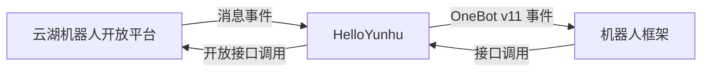

# 快速开始

本文档从零开始，把 HelloYunhu 接入一个已有的机器人框架，让[云湖](https://www.yhchat.com/)群里的消息到达框架，并让框架的回复回到群里。整个过程大约十分钟，按顺序做完第 1 节到第 7 节即可，第 8 节列出后续的文档入口。遇到报错时先看[常见问题](troubleshooting.md)。

## 1. 开始之前

HelloYunhu 的职责是协议转换：把云湖的消息事件换成 [OneBot v11](https://github.com/botuniverse/onebot-11) 格式转给框架，再把框架的接口调用换成云湖格式发往云湖。一次对话涉及三个部分，它们需要同时运行。

| 组成 | 职责 | 来源 |
|---|---|---|
| 云湖机器人 | 接收群里的消息，以机器人的身份发言 | 云湖机器人后台 |
| 机器人框架 | 决定收到消息以后回复什么内容 | 自行安装，例如 [AstrBot](https://github.com/AstrBotDevs/AstrBot) 或 [NoneBot2](https://github.com/nonebot/nonebot2) |
| HelloYunhu | 在两套协议之间转换 | 本仓库的发行包 |



两条连接都由 HelloYunhu 主动发起。框架先启动，在某个端口上等待连接，这个地址写进配置的 `onebot[].url`；HelloYunhu 随后启动，向框架发起反向 WebSocket，同时向云湖发起订阅连接。消息从云湖进入，经 HelloYunhu 转给框架，框架的回复沿同一条链路返回。

默认配置下，程序与框架位于同一台机器或同一个内网即可工作，公网地址与端口映射只在 Webhook 方式下需要。**把事件接收方式改成 Webhook 时，云湖必须能访问到监听端口**，第一次接入建议先用默认的订阅方式完成全流程。

## 2. 取得机器人令牌

在云湖机器人后台创建机器人，页面会给出机器人标识与令牌。程序用这个令牌代表机器人接收事件、发送消息，令牌泄露后到后台重置。

确认机器人已经加入要测试的群。群消息由机器人账号接收，机器人入群之后，群里 @机器人 的消息才能到达框架。

## 3. 准备程序

发行版提供三个平台的压缩包：`helloyunhu-linux-amd64.tar.gz`、`helloyunhu-windows-amd64.zip` 与 `helloyunhu-darwin-arm64.tar.gz`。解压后得到可执行文件 `helloyunhu`（Windows 上为 `helloyunhu.exe`）、`LICENSE`、`README.md` 与 `examples/config.yaml`。

程序是单个可执行文件，工作目录由启动位置决定，配置、数据库与日志都相对工作目录存放。建议为每个机器人单独准备一个目录，把可执行文件与配置放在一起。

需要自行构建时，安装 Go 1.27.4 之后执行：

```
go build -o bin/helloyunhu ./cmd/helloyunhu
```

仓库同时提供 `make build`，它与上面的命令等价，需要 GNU make。

确认程序能够运行：

```
$ helloyunhu version
helloyunhu dev
提交: none
构建时间: unknown
Go: go1.27.4 windows/amd64
```

## 4. 生成配置文件

在工作目录不带参数运行一次程序。它会生成 `config.yaml`，提示需要填写的两项，然后退出：

```
$ helloyunhu
已生成配置文件 config.yaml，本次不启动。
请填写以下两项后再次运行：
  bot.token          云湖机器人令牌
  onebot[0].url      机器人框架的 WebSocket 地址
```

生成的文件权限是 0600，内容包含机器人令牌。`config.yaml` 与 `data/` 已经在 `.gitignore` 中排除，放在仓库目录里也不会进入版本库。

## 5. 填写两项

打开 `config.yaml`，填写 `bot.token` 与 `onebot[0].url`：

```yaml
bot:
  token: "云湖机器人后台给出的令牌"

onebot:
  - name: astrbot
    url: ws://127.0.0.1:6199/ws
    access_token: ""
```

`onebot[0].url` 的取值由框架决定，下面是两个常见例子：

| 框架 | 反向 WebSocket 地址 |
|---|---|
| AstrBot，aiocqhttp 适配器 | `ws://127.0.0.1:6199/ws` |
| NoneBot2，adapter-onebot | `ws://127.0.0.1:8080/onebot/v11/ws` |

端口与路径都可以在框架的配置里修改，填写时以框架启动后打印的监听地址为准。框架开启了访问令牌时，把这个令牌填进 `access_token`，两侧的值保持一致。

其余配置项保持生成时的默认值即可。它们的含义与取值范围见[配置说明](configuration.md)。

## 6. 运行自检

自检会真实发起连接，依次检查配置、机器人信息、订阅连接与框架握手：

```
helloyunhu selftest -config config.yaml
```

正常情况下输出如下：

```
helloyunhu dev（提交 none）
Go: go1.27.4 windows/amd64

[通过] 配置检查: config.yaml，接收方式 websocket，框架连接 1 个
[通过] 机器人信息: botId=… 昵称=…
[通过] 订阅连接: 握手成功
[通过] 框架握手 astrbot: 握手成功

自检结束：4 项通过，0 项失败，0 项跳过
```

框架握手需要框架已经在运行。框架尚未启动时，这一项报告连接被拒绝，其余三项照常通过：

```
[失败] 框架握手 astrbot: dial tcp 127.0.0.1:6199: connectex: No connection could be made because the target machine actively refused it.
```

各项失败的含义与处理见[测试指南](testing.md)第 2 节。自检全部通过之后，进入启动步骤。

## 7. 启动并验证

先启动框架，再启动 HelloYunhu：

```
# 终端一：机器人框架，按框架自身的文档启动，例如 nb run

# 终端二：HelloYunhu
helloyunhu run -config config.yaml
```

日志里会出现下面四行，顺序可能略有出入：

```
level=INFO msg=程序启动 version=dev commit=none config=config.yaml receive_mode=websocket onebot_connections=1
level=INFO msg=已连接云湖机器人 bot_id=… nickname=…
level=INFO msg=已连接云湖事件订阅
level=INFO msg=已连接机器人框架 url=ws://127.0.0.1:6199/ws self_id=…
```

在群里 @机器人 发一句话。框架收到 `message.group` 事件，回复内容由框架里的插件决定；框架发回的消息经 HelloYunhu 转成云湖消息，群里随即出现机器人的回复。

按 Ctrl+C 结束进程，最后一行日志是 `msg=进程结束`。

## 8. 下一步

| 需要 | 文档 |
|---|---|
| 全部配置项的取值与默认值 | [配置说明](configuration.md) |
| 哪些消息类型、事件与接口可用 | [功能支持情况](compatibility.md) |
| 启动或运行时的报错 | [常见问题](troubleshooting.md) |
| 完整测试流程与自带的测试机器人 | [测试指南](testing.md) |

同一个云湖机器人要同时接入两个框架时，在 `onebot` 下追加一项并填写连接名称，事件会广播给两个框架。多个云湖机器人各自启动一个进程，每个进程使用独立的工作目录，数据库、日志与配置相互隔离。
